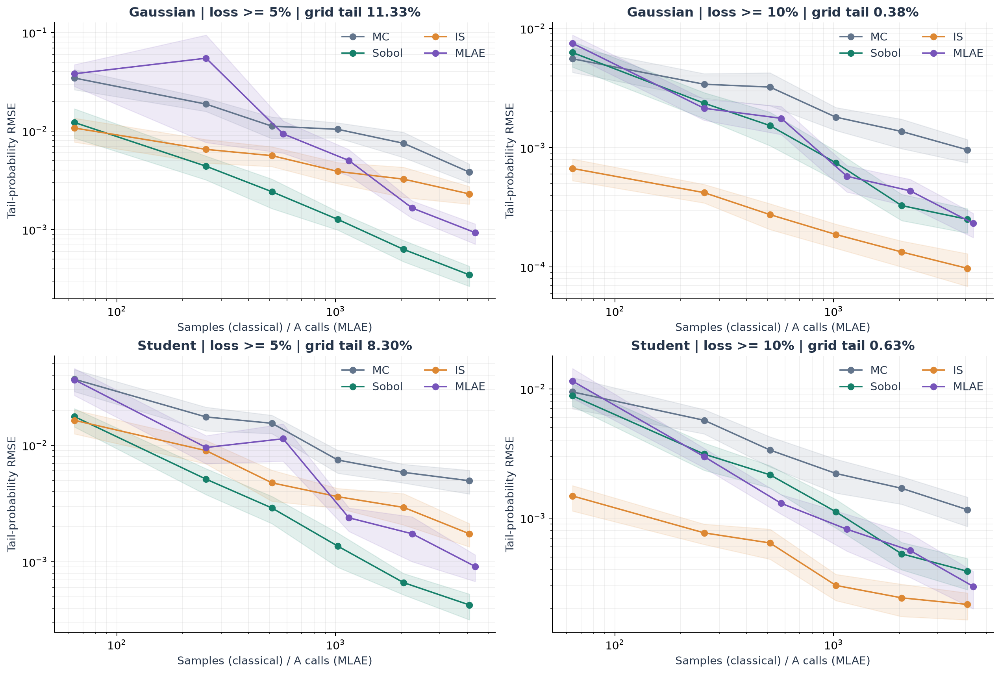

# TailRisk Lab

**Quantum amplitude estimation for portfolio tail risk, tested against strong classical estimators.**

How likely is a portfolio to lose at least 10% over ten trading days? TailRisk Lab builds a real Qiskit circuit for that event and measures the computation needed to estimate its probability. It compares quantum amplitude estimation with Monte Carlo, scrambled Sobol sampling, and importance sampling on exactly the same finite distribution.

Built for GT Qiskit Fall Fest 2026, Theme 1: Quantum Impact.

## Run it

Python 3.12 is the tested environment. No IBM account, API key, paid service, or quantum hardware is needed.

```bash
python3.12 -m venv .venv
source .venv/bin/activate
python -m pip install -r requirements.txt
python main.py demo
streamlit run app.py
```

The fitted public-data model is included, so the demo runs offline after dependencies are installed. Open the local URL printed by Streamlit. Use **Run IQAE** for a fresh finite-shot quantum experiment. The benchmark and diagnostic tabs show clearly labeled saved experiments.

Live circuit runs execute in a separate local Python process to keep the native Qiskit runtime independent of Streamlit rerun threads. Automatic file watching is disabled; restart Streamlit after changing Python source files.

For the exact recorded dependency environment, install `requirements.lock` instead. It includes development tools as well as transitive dependencies. On Windows, activate with `.venv\Scripts\activate`.

## What is implemented

- Kenneth French daily industry returns, compounded into ten-trading-day losses.
- Gaussian validation model and Student-t marginals joined by a Gaussian copula.
- Cell-integrated joint probabilities, exact grid tail probability, VaR, and expected shortfall.
- A 7-qubit direct threshold oracle and an 18-qubit weighted-adder/comparator oracle at the default grid size.
- Finite-shot IQAE with confidence intervals and fixed-budget MLAE with repeated trials.
- Monte Carlo, two-dimensional scrambled Sobol, and full-support importance sampling.
- Actual shot, Grover-power, A/A-dagger, depth, and two-qubit-gate accounting.
- Interval-aware quantum VaR search and positive-excess amplitude estimation for expected shortfall.
- Grid convergence, oracle-resource comparison, and a depolarizing-noise sensitivity study.
- A local interactive demo, raw result tables, figures, and tests.



## The experiment

We use the **BusEq** (business equipment) and **Enrgy** (energy) columns from the value-weighted Kenneth French 12-industry daily file, January 2000 through December 2025. The saved calibration uses 6,539 daily observations and 6,530 overlapping ten-day windows. The current source archive identifies the August 2026 CRSP database vintage.

For loss L and threshold x, the target is `P(L >= x)`. With three qubits per asset there are 64 joint scenarios. We calculate the exact probability by summing their probability masses, then ask each estimator to recover that answer.

The quantum state contains the square roots of all joint scenario probabilities. An objective qubit is flipped by the loss predicate. The circuit does **not** calculate the answer classically and place it in a one-qubit rotation. Amplitude amplification and estimation operate on the full prepared state.

The default benchmark runs two model families, two loss thresholds, six budgets, and 30 independent replicates per point. Quantum points use Qiskit's maximum-likelihood amplitude estimation with predeclared Grover schedules. This gives a fixed query budget; IQAE is reported separately because it adapts its budget to an accuracy target.

See [methodology](docs/METHODOLOGY.md) for the mathematics and comparison assumptions, [results](docs/RESULTS.md) for measured findings, and [data provenance](data/README.md) for the source and calibration details.

## Reproduce the results

```bash
# Optional: download the current source archive and refit the models.
python main.py prepare-data

# Default saved benchmark: 30 replicates per point, actual Aer circuits.
python main.py benchmark

# Oracle, grid, IQAE, VaR, expected-shortfall, and noise experiments.
python main.py studies

# Generate plots from saved results.
python main.py figures

# Optional: measure a single-run classical/quantum timing breakdown.
python -m scripts.profile_pipeline
```

A small experiment can be run with `python main.py benchmark --replicates 3 --levels 3 --output results/smoke`. The full benchmark is intentionally separate from opening the app. Exact runtime depends on the machine; circuit compilation is cached within each scenario, and simulator execution is restricted to one thread per run.

```bash
python -m pip install -r requirements-dev.txt
python -m pytest -q
ruff check tailrisk tests main.py app.py
```

Tests verify compounding, missing-data handling, grid cell masses, discrete expected shortfall, importance weights, Sobol's target distribution, threshold boundaries, bit ordering, arithmetic workspace cleanup, the Grover rotation law, and finite-shot query accounting.

## Reading the results honestly

1. **Query counts are not runtime.** Classical scenario samples and coherent quantum A/A-dagger calls are different resources. We show both the query experiment and measured simulator timings.
2. **This small problem is classically easy.** Exact grid enumeration wins. The Gaussian linear portfolio also has an analytic solution. The Student-copula model has an efficient numerical quadrature reference in two dimensions.
3. **Distribution loading has a cost.** Arbitrary state preparation and direct scenario marking grow with the probability table. All gate reports include state preparation; the experiment does not solve scalable loading.
4. **Grid error is separate.** A precise estimate of a coarse grid can still be inaccurate for the continuous model. We show truncation and quantization effects separately.
5. **No practical quantum advantage is claimed.** Any observed improvement is qualified by the estimator, measured budget, ideal-circuit assumption, and access model. Noise can erase the improvement.

## Repository map

| File | Purpose |
| --- | --- |
| `app.py` | Interactive local demo |
| `main.py` | Command-line experiments |
| `tailrisk/data.py` | Public-data parsing and return compounding |
| `tailrisk/models.py` | Model fitting, cell integration, exact risk |
| `tailrisk/classical.py` | MC, Sobol, importance sampling |
| `tailrisk/quantum.py` | Oracles, QAE, query ledger, VaR/ES |
| `tailrisk/live.py` | Local process entry point for live circuit runs |
| `tailrisk/experiments.py` | Reproducible experiments and metadata |
| `tailrisk/figures.py` | Plots from measured data |
| `tests/` | Numerical and circuit correctness |
| `results/` | Raw results, execution ledgers, and figures |

## Prior work and contributions

QAE and quantum financial risk analysis are established methods. This project contributes the data pipeline, comparison protocol, oracle implementation comparison, circuit accounting, diagnostics, and demo. We use the Qiskit Algorithms implementations of IQAE and MLAE. No existing application repository was forked. AI assisted implementation, debugging, documentation, and experiment design during the hackathon.

- [Woerner and Egger, Quantum risk analysis (2019)](https://www.nature.com/articles/s41534-019-0130-6)
- [Grinko et al., Iterative Quantum Amplitude Estimation](https://arxiv.org/abs/1912.05559)
- [Qiskit Finance risk tutorial](https://qiskit-community.github.io/qiskit-finance/tutorials/09_credit_risk_analysis.html)
- [Qiskit Algorithms](https://qiskit-community.github.io/qiskit-algorithms/)
- [SciPy Sobol documentation](https://docs.scipy.org/doc/scipy/reference/generated/scipy.stats.qmc.Sobol.html)
- [Kenneth French Data Library](https://mba.tuck.dartmouth.edu/pages/faculty/ken.french/data_library.html)
- [Rockafellar and Uryasev, CVaR for general loss distributions](https://sites.math.washington.edu/~rtr/papers/rtr187-CVaR2.pdf)
- [Chakrabarti et al., resource estimates for derivative pricing](https://quantum-journal.org/papers/q-2021-06-01-463/)

Project code is MIT licensed. Third-party packages and source data retain their own licenses and terms.
