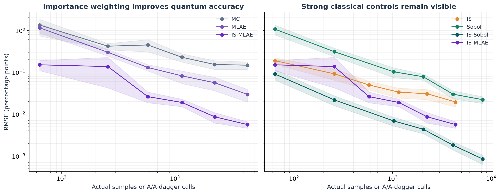

# Importance-weighted quantum amplitude estimation

The improved estimator combines the existing classical importance proposal with Qiskit maximum-likelihood amplitude estimation (IS-MLAE). It achieves lower measured RMSE than ordinary MC, ordinary IS, and plain MLAE at the upper tested budgets. This is an ideal-circuit, accuracy-per-query result. Importance-weighted Sobol and exact grid summation remain stronger classical options for this small problem.

## Construction

Let p_i be the original scenario probability, f_i the loss-threshold indicator, and q_i the same defensive exponential-tilt proposal used by classical IS. Define h_i = p_i f_i / q_i and B = max_i h_i. Prepare amplitudes sqrt(q_i), then apply a controlled objective rotation with angle 2 asin(sqrt(h_i/B)). The objective probability is

    a = sum_i q_i h_i / B = P(loss >= threshold) / B.

Run amplitude estimation on that full seven-qubit circuit and report B times its estimate. The original tail probability is never supplied to circuit construction. Exact summation is used only for verification and evaluation. A zero-payoff case uses B=1 and an unmarked objective.

This combines two familiar ideas; it is not a claim to invent importance sampling or amplitude estimation. On this grid, B=0.04044994 and the objective probability is about 0.155641, compared with the unweighted tail probability 0.006295665. Rotations encode individual likelihood-weighted payoffs, not a classically calculated answer.

## Experiment and results

The fixed model is Student-t marginals with a Gaussian copula, 50/50 portfolio weights, 64 scenarios and a 10% ten-day loss threshold. There are 30 independent runs at each of six fixed schedules. Each circuit receives 64 finite shots. All six budgets are retained, including the weak result at N=256. Seeds and schedules are in the manifest.

MC, IS and plain MLAE reuse the unchanged matched-budget trials. IS-MLAE, Sobol and IS-Sobol have 540 new trials, including 180 actual finite-shot Aer quantum runs. Development used one deeper plain-MLAE pilot and one weighted pilot; neither is counted in the replicated results. The weighted study uses fresh seeds and no fitted schedule or cherry-picked random seed.



Endpoint RMSE is in percentage points of probability:

| Estimator | Actual budget | RMSE (pp) | 95% bootstrap RMSE interval (pp) |
| --- | ---: | ---: | ---: |
| Ordinary Monte Carlo | 4,352 | 0.1472 | 0.1160-0.1765 |
| Plain quantum MLAE | 4,352 | 0.0296 | 0.0194-0.0391 |
| Classical importance sampling | 4,352 | 0.0195 | 0.0148-0.0237 |
| Quantum IS-MLAE | 4,352 | 0.00563 | 0.0046-0.0066 |
| Scrambled Sobol | 8,192 | 0.0221 | 0.0179-0.0260 |
| Importance-weighted Sobol | 8,192 | 0.00085 | 0.0006-0.0011 |

At N=4,352, IS-MLAE has 26.2 times lower point-estimate RMSE than MC, 3.5 times lower than ordinary IS, and 5.3 times lower than plain MLAE. These factors are finite-experiment point estimates, not guaranteed speedups. Bootstrap intervals use 2,000 resamples. They quantify trial variability and do not include model error.

MC, IS and both quantum methods use equal numerical budgets. A quantum shot at Grover power k counts 2k+1 calls to the relevant preparation circuit A or its inverse. Sobol methods receive the next power-of-two budget to preserve their balance properties, favoring the classical comparison; the plot uses their actual sample counts. IS-Sobol is also more accurate at 4,096 samples than IS-MLAE is at 4,352 calls.

The exact classical IS RMSE is sqrt(Var_q(h)/N), with Var_q(h)=0.0001641290 for this proposal. The raw summary includes this reference. The experiment does not handicap classical IS by making it estimate an additional Bernoulli rotation; classical IS observes the full weighted payoff h_i.

## What this supports

A precise claim is: **In our ideal-circuit benchmark, importance-weighted quantum amplitude estimation achieves about 26 times lower RMSE than Monte Carlo and 3.5 times lower RMSE than classical importance sampling at the same numerical query budget.**

The potential application is high-precision expectation estimation when a useful proposal and coherent reversible sampler can be implemented efficiently, while exact summation is impractical. Standard QAE results motivate improved precision scaling under coherent access, but this experiment does not demonstrate that application at useful scale. It does not establish a win over every classical algorithm.

The seven-qubit weighted preparation circuit has 121 CX gates and depth 534 with the documented all-to-all transpilation basis. This includes distribution loading and payoff rotations; it is not a hardware-routing estimate. The quantum estimator's median simulator time at N=4,352 is about 1.28 seconds, versus 0.00016 seconds for classical IS. CPU simulation is not a QPU runtime measurement.

Both methods use a full classical probability table here. Finding B and loading q require table access, and exact summation already solves this table cheaply. A scalable implementation would need an efficient reversible proposal and a computable payoff bound, rather than enumerating the distribution. Noise and grid bias remain separate limitations. The prior noise experiment used the unweighted circuit, so it must not be presented as a noise test of this new estimator.

## Reproduce

```bash
python main.py importance
python main.py figures
python -m pytest -q
```

The matched-budget CSV must exist first; it is included in the repository. Results are in `results/importance/`: the manifest, per-trial estimates, bootstrap summaries and complete shot/Grover-power query ledger. The UI displays all six methods.

References: [Suzuki et al., amplitude estimation without phase estimation](https://arxiv.org/abs/1904.10246), [Montanaro, quantum speedup of Monte Carlo methods](https://arxiv.org/abs/1504.06987). These motivate quantum mean estimation; the finite-table construction and measurements above are this repository's implementation.
