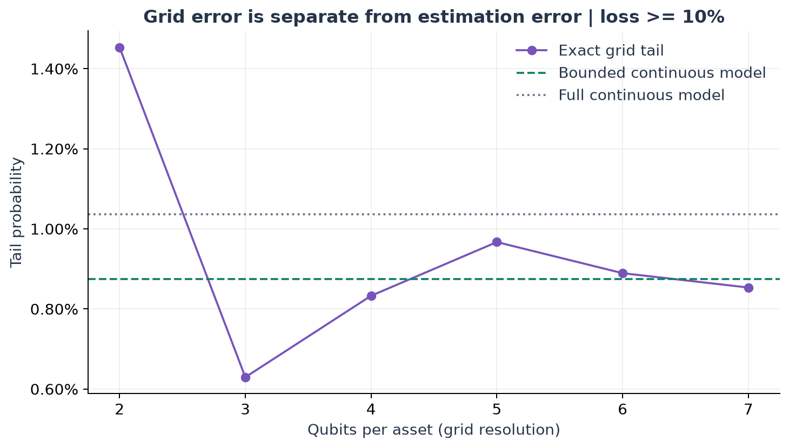
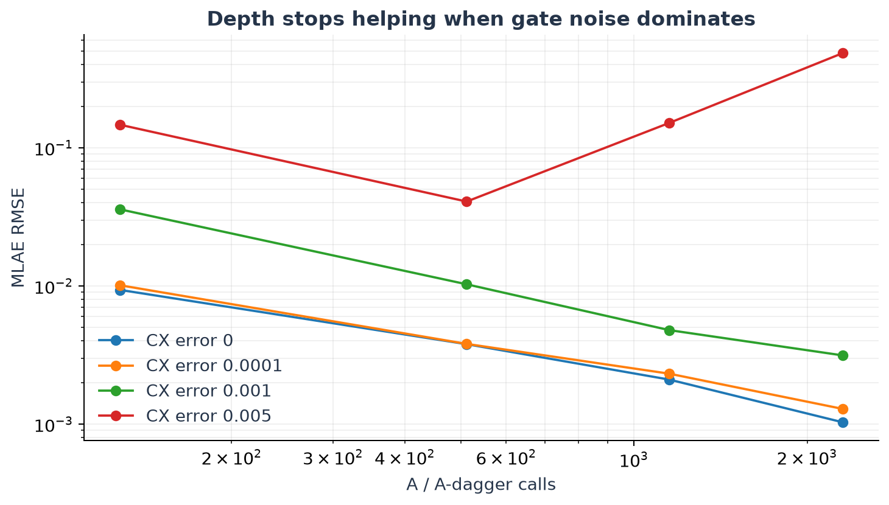

# Measured results

These results were produced on October 10, 2026, using the included parameter snapshot, Python 3.12, Qiskit 2.5.2, Qiskit Algorithms 0.4.0, and Aer 0.17.2 on an Apple Silicon Mac. Full environment metadata and seeds are in the result manifests.

## What the benchmark establishes

The benchmark contains **2,880 estimator runs**, including **720 finite-shot quantum runs**: two model families, two loss thresholds, six budgets, four estimators, and 30 independent replicates per point. The quantum method is MLAE with fixed schedules; IQAE appears in separate accuracy-target and live-demo experiments.

At the largest tested budgets, quantum MLAE has lower RMSE than ordinary Monte Carlo in all four scenarios. Strong classical competitors remain important: Sobol performs best at the 5% loss threshold, while importance sampling performs best at the 10% threshold. There is no demonstrated practical quantum advantage.

### Largest tested budgets

RMSE is in absolute probability units. Classical estimators use 4,096 samples; MLAE uses 4,352 A/A-dagger calls. The 6.25% difference is explicit, and these units do not imply equal runtime.

| Model / loss threshold | MC | Sobol | Importance sampling | Quantum MLAE |
| --- | ---: | ---: | ---: | ---: |
| Gaussian / 5% | 0.003825 | 0.000347 | 0.002300 | 0.000930 |
| Gaussian / 10% | 0.000959 | 0.000251 | 0.000097 | 0.000232 |
| Student copula / 5% | 0.004953 | 0.000426 | 0.001737 | 0.000910 |
| Student copula / 10% | 0.001160 | 0.000387 | 0.000215 | 0.000296 |

The complete bootstrap RMSE intervals are in `results/benchmark/summary.csv`. Point estimates should not be treated as decisive rankings where uncertainty bands overlap. In particular, the Student 10% case does not establish a decisive quantum-versus-Sobol ranking at the largest budget.

### A concrete accuracy target

For the Student-copula model and a 10% loss threshold, the grid tail probability is 0.006295664936, or about 0.630%. Set the desired empirical RMSE to 0.002, equal to 0.2 percentage points of probability. The first tested budgets whose **upper bootstrap RMSE band** meets this target are:

| Method | First observed budget |
| --- | ---: |
| Importance sampling | 64 samples |
| Quantum MLAE | 576 A/A-dagger calls |
| Scrambled Sobol | 1,024 samples |
| Monte Carlo | 4,096 samples |

This is a useful example of why the baseline matters. Quantum reaches the chosen measured accuracy with fewer coherent query units than the MC sample count, but importance sampling reaches it with fewer classical samples. These are discrete observed budgets, not interpolated minimal costs or guaranteed future performance. Exact enumeration of the 64-state PMF remains faster than all four estimators.

### Empirical convergence

For the Student 10% scenario, an ordinary least-squares fit of log(RMSE) against log(actual budget) over the six recorded points gives slopes of approximately -0.52 for MC, -0.78 for Sobol, -0.50 for IS, and -0.85 for MLAE. These are descriptive finite-budget slopes, not asymptotic proofs. Some quantum curves are nonmonotonic at low budgets because finite-shot maximum-likelihood estimation can select an incorrect likelihood branch.

## Live IQAE demonstration

Default settings: Student-copula model, 50/50 weights, a 10% loss threshold, three qubits per asset, target absolute error 0.01, failure probability 0.05, and seed 17.

| Quantity | Result |
| --- | ---: |
| Exact grid tail probability | 0.629566% |
| IQAE estimate | 0.632387% |
| 95% IQAE interval | [0.482417%, 0.782358%] |
| A/A-dagger calls | 2,560 |
| Total circuit shots | 512 |
| Maximum Grover power | 4 |

The realized interval is tighter than the requested tolerance in this run. This is one seeded demonstration, not an estimator ranking. `results/demo.json` contains the actual shot ledger.

## Oracle implementations

Both implementations reproduce the same 0.006295664936 tail amplitude probability within 1e-12. The arithmetic circuit's nonzero-workspace probability is below 1e-12 after uncomputation.

| Oracle | Qubits | CX gates | Depth | Total gates |
| --- | ---: | ---: | ---: | ---: |
| Direct scenario marking | 7 | 1,297 | 2,249 | 3,403 |
| Weighted adder and comparator | 18 | 937 | 1,837 | 2,667 |

The arithmetic circuit uses more qubits but about 28% fewer CX gates in this particular synthesis. This is an implementation tradeoff, not a general scaling result. Counts include state preparation and use rz/sx/x/cx with optimization level 1, seed 17, and unrestricted connectivity. The main replicated benchmark uses the direct oracle.

## VaR and expected shortfall

For 95% risk confidence on the default grid:

- The interval-aware quantum VaR search resolves the quantile to **6.25%**, matching the exact grid quantile, with **18,944 A calls** across the search.
- Exact discrete expected shortfall is **8.1853%**.
- The positive-excess quantum estimate is **8.1321%**, with conditional interval **[8.0449%, 8.2192%]**.

The ES experiment uses the quantile returned by the resolved quantum VaR search. Its interval is conditional on the supplied quantile; combining two 95% procedures gives at least 90% joint coverage by the stated union-bound argument. We do not present it as a 95% end-to-end guarantee.

## Grid and truncation effects

For the Student-copula 10% loss event:

| Reference | Tail probability |
| --- | ---: |
| Full continuous model | 1.0365% |
| Continuous model conditioned on the grid bounds | 0.8742% |
| Default 64-scenario grid | 0.6296% |
| Finer 16,384-scenario grid | 0.8535% |

The two-asset bounding box retains 99.6310% of the model probability. The default grid is visibly coarse, and grid convergence is not monotonic because the indicator threshold moves relative to cell midpoints. More precise amplitude estimation alone cannot correct those errors. The 99.9% risk display should be treated as exploratory: omitted joint probability exceeds 0.1%.

## Noise sensitivity

The noise study uses a separate five-qubit, 16-scenario circuit and ten replicates per setting. At its largest budget of 2,304 A calls, ideal MLAE RMSE is about **0.00103**. With a 0.001 depolarizing parameter after each CX it rises to about **0.00315**. With parameter 0.005 it reaches about **0.485**, and deeper schedules are actively harmful in this regime.

This is an intentionally simple sensitivity study. It does not predict performance on a named quantum processor or preserve ideal-model confidence guarantees under noise.

## Runtime and reproducibility

At the largest Student 10% budgets, median classical estimator times are roughly 0.0002-0.0004 seconds, while MLAE's median simulator time is about 2.65 seconds. Compilation is cached within each scenario. These are measurements on one machine, not physical quantum execution times.

`results/timing.json` separately records a cold IQAE run, model loading, grid construction, continuous reference evaluation, and exact grid evaluation. Exact enumeration takes tens of microseconds in that profile after the PMF exists. Model fitting and data acquisition are excluded and explicitly identified as such.

The original 33-test suite passed in a fresh environment installed from `requirements.lock`. The scaling extension adds three evidence audits, bringing the passing suite to 36 tests. The saved original benchmark was checked for 30 replicates per point and reconciled against all 720 quantum execution ledgers. Tests also verify both oracle implementations, workspace cleanup, Grover amplification, discrete ES, classical target distributions, confidence-aware search behavior, and stale-result handling in the app. See [the matched-N and scenario-count study](SCALING.md) for the newer comparisons.

## Next technical steps

The most useful extension is structured state preparation with a cost model that can scale beyond an explicitly tabulated PMF. After that, test more complex loss functions and higher-dimensional models with strong variance reduction, allocate a full model/discretization/estimation error budget, and perform approximate Clifford+T synthesis with explicit tolerances. Each extension should retain the classical references and independent replication used here.
