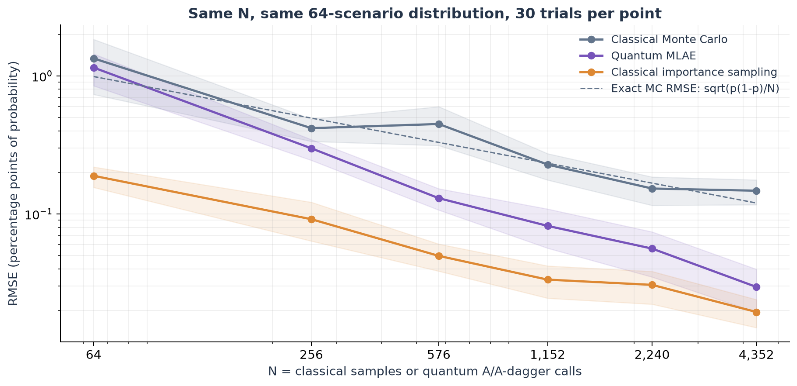
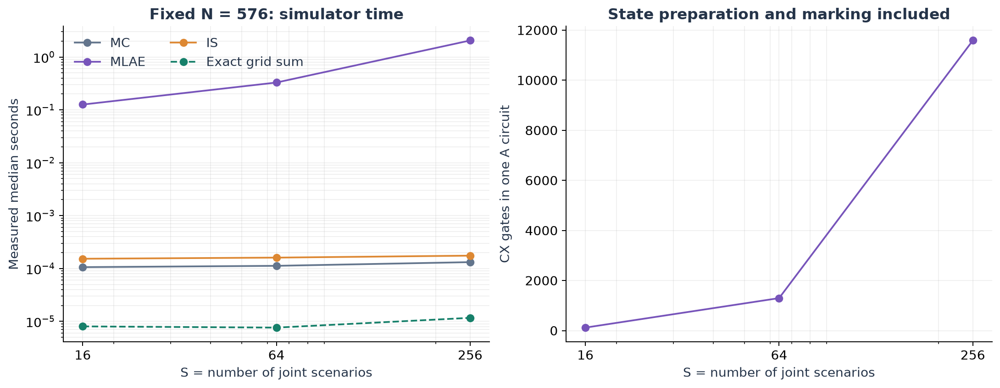

# Scaling benchmark

A subsequent [importance-weighted quantum estimator](IMPORTANCE.md) improves on plain MLAE and ordinary IS. This document retains the original unweighted comparison unchanged.

## What N means

N is a computation budget. One classical unit is one sampled scenario. One quantum unit is one coherent application of A or its inverse. A shot at Grover power k costs 2k+1 such units, including the initial A. These counts are numerically matched, not equal in runtime or hardware cost. S denotes the number of joint grid scenarios. The number of assets remains two.

## Error versus N, with S fixed at 64

The Student-copula model, 50/50 weights and 10% loss threshold are fixed. The exact grid tail is 0.629566%. Each method has 30 independent trials at each N. MLAE trials are reused unchanged from the original benchmark; new MC and IS trials use exactly those budgets. No additional quantum trials are claimed for this reuse.



RMSE below is in percentage points of probability (100 times absolute probability RMSE). Lower is better.

| N | Monte Carlo RMSE | Quantum MLAE RMSE | Importance sampling RMSE |
| ---: | ---: | ---: | ---: |
| 64 | 1.3373 | 1.1477 | 0.1888 |
| 256 | 0.4179 | 0.2986 | 0.0915 |
| 576 | 0.4479 | 0.1300 | 0.0496 |
| 1,152 | 0.2276 | 0.0819 | 0.0334 |
| 2,240 | 0.1527 | 0.0561 | 0.0306 |
| 4,352 | 0.1472 | 0.0296 | 0.0195 |

At N = 4,352, MLAE has about 5.0 times lower measured RMSE than ordinary MC. Importance sampling remains better than MLAE on the point estimates. This result is specific to this model, estimator schedule, ideal simulation and finite range of N. Confidence bands are in `results/scaling/budget_summary.csv` and the plot.

Classical Bernoulli MC has exact RMSE sqrt(p(1-p)/N), shown as a dashed reference. The empirical log-log slopes over six budgets are -0.53 (MC), -0.85 (MLAE), and -0.54 (IS). Ideal QAE query-complexity results can approach error order 1/N, up to confidence/logarithmic factors, under coherent oracle access. These finite-budget measurements do not establish that theorem or practical speedup.

The first tested budgets whose upper bootstrap RMSE band meets 0.2 percentage points are 256 (IS), 576 (MLAE), and 2,240 (MC). These differ from the original power-of-two-budget study because the budgets and classical random seeds differ. They are observed thresholds, not guarantees or theoretical minimum costs. Use the matched-N results consistently when discussing this experiment. Sobol remains in the broader original benchmark at its actual power-of-two sample counts.

## Cost versus S, with N fixed at 576

We refine the same two-asset grid: S = 2^(2b) for b = 2, 3, 4 bits per asset. MLAE uses 64 shots at each of k = 0, 1, 2, so N = 64(1+3+5) = 576. MC and IS also use 576 samples. There are 30 new trials per method and grid size, including 90 new quantum runs. Each grid has its own exact probability. This is a resolution and implementation-cost study, not asset-count scaling.



| Scenarios S | Qubits | CX per A | Median MC seconds | Median MLAE seconds | Exact grid tail |
| ---: | ---: | ---: | ---: | ---: | ---: |
| 16 | 5 | 119 | 0.000106 | 0.126 | 1.4534% |
| 64 | 7 | 1,297 | 0.000112 | 0.329 | 0.6296% |
| 256 | 9 | 11,587 | 0.000132 | 2.051 | 0.8330% |

Gate counts include state preparation and scenario marking, with basis rz/sx/x/cx, optimization level 1 and unrestricted connectivity. The growth from 119 to 11,587 CX gates exposes the cost hidden by a unit-cost oracle model. Three sizes are not enough to fit a reliable asymptotic gate-complexity exponent.

Timings are CPU/Aer wall-clock measurements. The estimator timer includes first-use compilation, with compiled circuits cached for later replicates. Medians primarily reflect warm runs. Resource compilation, grid construction, oracle construction and exact enumeration have separate recorded timings. The scenario study ran separately from the original benchmark. It does not measure a physical quantum processor. Exact grid summation is faster at every tested size.

## Reproduction

```bash
python main.py scaling
python main.py figures
python -m pytest -q
```

The command regenerates matched-budget classical trials and the scenario study. It reuses the included original MLAE records, whose full circuit ledgers remain in `results/benchmark/quantum_circuits.json`. `results/scaling/` includes manifests, seeds, raw errors, bootstrap summaries, resources and the new circuit ledgers. The summary uses 2,000 bootstrap resamples. All source data needed by the default run are included.

## Primary references

- [Iterative Quantum Amplitude Estimation](https://arxiv.org/abs/1912.05559)
- [Qiskit MLAE implementation](https://qiskit-community.github.io/qiskit-algorithms/stubs/qiskit_algorithms.MaximumLikelihoodAmplitudeEstimation.html)
